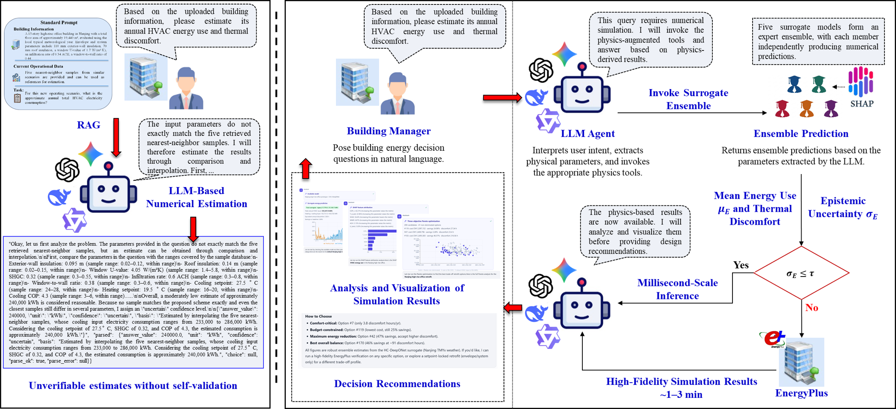

# Physics-Augmented Generation (PAG): An Agent Framework for Building Energy Simulation via Collaboration between LLMs and Operator Surrogates

[English](README.md) | [中文文档](README_CN.md)

> Ask in natural language; the agent runs **physics surrogate models** for quantitative analysis and uses **uncertainty gating** to decide when to trust the surrogate and when to fall back to a real **EnergyPlus** simulation — *trust what it knows, simulate what it does not*.

A physics-simulation-augmented LLM agent that turns expert-grade, high-fidelity building simulation into a conversational decision service for everyone.



---

## Core Idea: RAG → PAG + Uncertainty Gating

- **PAG (Physics-Augmented Generation)** upgrades the LLM's augmentation source from "retrieve a text snippet / a table" to "call a physics engine": a data-driven surrogate plus a high-fidelity simulator take numerical reasoning out of the LLM's hands, suppressing numerical hallucination.
- **Uncertainty gating**: the surrogate is a 5-member deep ensemble of HC-DeepONet that outputs a predicted energy mean **μ_E** and an ensemble disagreement **σ_E**:
  - low **σ_E** (within the training distribution) → trust the surrogate directly, millisecond-scale;
  - high **σ_E** (extrapolation / extreme conditions such as anomalous climate or out-of-range envelope parameters) → fall back to a **parameterized EnergyPlus** simulation for authoritative verification, tens-of-seconds scale.
- Division of labor: the **LLM** understands the question, plans, explains and weighs trade-offs; the **physics surrogate / simulator** is responsible for getting the numbers right.

## Pages & Features

- **Agent Chat** (core page): natural-language conversation with token-by-token streaming. Tool-call results are rendered inline in the conversation — gating badges (🟢 trust surrogate / 🔴 fallback recommended), source badges (⚙ high-fidelity EnergyPlus), and charts such as daily curves, Pareto scatter plots, bar charts and SHAP plots; live progress during fallback simulations.
- **Design / Retrofit**: fixed Nanjing climate; adjust building parameters → annual cooling/heating input curves, annual equivalent discomfort, and a three-objective Pareto front (cost – robust cooling/heating input – discomfort).
- **Operation**: fixed building; adjust HVAC setpoints → annual cooling/heating input curves and the energy saved by raising the cooling setpoint by 1 °C in summer.
- **Extreme / Anomalous Years (OOD)**: benchmark against normal-climate daily means; pick anomalous-year EPW scenarios (`anom_warm` / `anom_balanced` / `anom_cold`) to estimate daily peaks and their increases.
- **Feature Attribution**: SHAP feature importance and direction of influence.
- **Principles**: methodology and metric definitions.
- **Training Workbench**: multi-turn specification conversation (text + building images) → dataset generation → training a new surrogate model, plus model-library management (`GET /api/models`, `POST /api/models/select`).
- **Report Generation**: one-click energy & comfort PDF report (`POST /api/reports/energy-comfort`).

## Agent Tools (Function Calling)

Seven tools the agent can call (lazily reusing the existing backend inference functions, see `backend/agent/tools.py`):

| Tool | Purpose | Scenario |
| --- | --- | --- |
| `predict_energy` | Annual energy μ_E + σ_E + **gating verdict** for a single design | General |
| `optimize_pareto` | Three-objective Pareto search (cost – energy – comfort) | Design / retrofit |
| `operation_savings` | Setpoint savings, incl. summer cooling setpoint +1 °C | Operation |
| `estimate_extreme` | Anomalous-year (OOD) energy peaks and increases | Extreme climate |
| `explain_features` | SHAP attribution of driving factors | Explanation |
| `run_energyplus_simulation` | Real high-fidelity EnergyPlus run (~70–80 s, async + progress) | Gating fallback / authoritative verification |
| `list_available_models` | List building surrogate models in the model library | Model selection |

## Architecture

```
Frontend React + Vite ── POST /api/agent/chat (SSE streaming) ──► FastAPI backend (:8010)
  · Agent chat + showcase pages + training             · agent/orchestrator    function-calling loop (DeepSeek)
  · Tool cards / gating badges / inline charts         · agent/tools           7 tool schemas + dispatch
                                                       · agent/gating          σ_E gating (p95 threshold)
                                                       · agent/eplus_fallback  real EnergyPlus (async + progress heartbeat)
                                                       · report_routes         PDF report generation
                                                       · training_routes       training workbench + model library
                               path sharing ▼
                  ../models (HC-DeepONet ensemble), ../datasets — shared with the parent folder, no copying needed
```

- **Provider abstraction**: DeepSeek by default (`deepseek-chat`, OpenAI-compatible); switch to Alibaba DashScope / OpenAI / any OpenAI-compatible endpoint without touching callers (see `backend/agent/config.py`).
- **Streaming events**: `delta` (text increment) / `tool_call` / `tool_result` / `progress` / `done` / `error`.
- Backend CORS is open to any local port, so the frontend port is arbitrary.

## QA Benchmark (`qa_benchmark/`)

A reproducible benchmark that measures how much physics augmentation reduces numerical hallucination on building-energy questions.

- **Questions**: 45 natural-language questions (`questions/questions_v1.yaml`) — 20 in-distribution / 15 edge / 10 OOD, across four types (point prediction / scheme comparison / savings / scenario estimation). Tiers are deliberately hidden in the wording so models cannot guess when to refuse.
- **Ground truth**: every answer comes from real EnergyPlus simulations (held-out samples, design-OOD points, anomalous-year EPWs), never from the surrogate.
- **Frameworks compared**: **LLM-only** vs **LLM+RAG** vs **PAG** (surrogate + uncertainty gating with EnergyPlus fallback); 3 repetitions each (405 Q&A, `temperature=0`).
- **Headline results (DeepSeek-chat, rep 1)**: usable-answer rate **PAG 97.8% (44/45)** vs **0% / 0%** for the two baselines; PAG median numerical error **1.4%** in-distribution, **2.1%** at the edge, **≈0%** OOD (EnergyPlus fallback) — vs ~198% / ~16.6% / ~64.9% for the baselines. Zero gating misses, 61/61 parameter groups parsed correctly, 10/10 comparison directions correct. Median latency: surrogate path **5.2 s**, fallback path **40.9 s**.
- **Model sweep** (`results/model_sweep/`): the same three frameworks across Gemini 3.5 Flash / GPT-5.5 / Qwen3.7-Plus, with raw JSONL, scored CSVs and figures (verdict stacks, error strips, raincloud / box plots by framework × model).
- **Reproducible**: fixed random seed in `questions/make_questions.py`; all runner and scoring scripts live in `runners/` (`run_llm_only.py`, `run_llm_rag.py`, `run_pag.py`, `run_model_matrix.py`, `score.py`, `score_model_sweep.py`, …).

## Directory Structure

```
EnergyPlus-Agent/
├─ backend/
│  ├─ app.py                 # FastAPI main app (display endpoints) + routers (agent/report/training)
│  ├─ report_routes.py       # /api/reports/* — PDF report generation
│  ├─ training_routes.py     # training workbench + model library (/api/models)
│  ├─ requirements.txt
│  ├─ .env                   # LLM key (gitignored, never committed)
│  └─ agent/
│     ├─ config.py           # provider abstraction + dependency-free .env loading
│     ├─ llm.py              # OpenAI-compatible client wrapper
│     ├─ routes.py           # /api/agent/chat (SSE) + /api/agent/health
│     ├─ orchestrator.py     # streaming function-calling loop + system prompt
│     ├─ tools.py            # the 7 tools
│     ├─ gating.py           # σ_E uncertainty gating
│     └─ eplus_fallback.py   # real EnergyPlus fallback (async + progress)
├─ frontend/
│  └─ src/
│     ├─ App.jsx             # home + scene routing (agent chat, showcase pages, training)
│     ├─ AgentPage.jsx       # chat page (streaming / tool cards / Markdown)
│     ├─ ChatCharts.jsx      # inline conversation charts (Recharts)
│     ├─ TrainingPage.jsx    # training workbench
│     ├─ agent.css / styles.css / training.css
│     └─ api/client.js       # SSE parsing
├─ qa_benchmark/             # QA benchmark: questions, runners, results (see above)
├─ scripts/
│  └─ start.ps1              # one-click start (backend :8010 + frontend :5173)
├─ Frame.png                 # English framework diagram
└─ Frame_zh.png               # Chinese framework diagram
```

## Pretrained Models

The trained 5-member HC-DeepONet ensemble (weights, scalers, gating thresholds and the SHAP table used at runtime) is published as a release asset: [v1.0.0](https://github.com/Zhangchaokai1/EnergyPlus-Agent/releases/tag/v1.0.0) → `energyplus-agent-models-v1.0.0.zip` (~8.7 MB).

```bash
# run in the parent folder of EnergyPlus-Agent/
curl -LO https://github.com/Zhangchaokai1/EnergyPlus-Agent/releases/download/v1.0.0/energyplus-agent-models-v1.0.0.zip
unzip energyplus-agent-models-v1.0.0.zip   # creates models/ next to EnergyPlus-Agent/
sha256sum -c SHA256SUMS
```

Training/simulation datasets are not distributed (too large).

## Configuration

**1) Backend LLM key** — `backend/.env` (gitignored, never committed):

```dotenv
LLM_PROVIDER=deepseek
DEEPSEEK_API_KEY=sk-your-key
```

Switch to Alibaba DashScope: `LLM_PROVIDER=dashscope` + `DASHSCOPE_API_KEY=...`; to OpenAI: `LLM_PROVIDER=openai` + `OPENAI_API_KEY=...`. You can also override explicitly with `LLM_BASE_URL` / `LLM_MODEL` / `LLM_API_KEY`.

**2) Frontend API base** — `frontend/.env.local`:

```dotenv
VITE_API_BASE=http://127.0.0.1:8010
```

Keep it in sync with the backend port and restart `npm run dev` after changes.

## Run

One-click start script (agent backend on **8010**, frontend on **5173**, runs `npm install` automatically if needed):

```powershell
cd EnergyPlus-Agent
.\scripts\start.ps1
```

Or manually in two terminals:

```powershell
# Terminal 1 — backend (avoid --reload on Windows: its exit can leave the port occupied)
cd EnergyPlus-Agent
python -m uvicorn backend.app:app --host 127.0.0.1 --port 8010

# Terminal 2 — frontend
cd EnergyPlus-Agent\frontend
npm install
npm run dev        # http://127.0.0.1:5173
```

- Health check: `GET http://127.0.0.1:8010/api/agent/health` → `{provider, model, configured}`.
- Model library: `GET http://127.0.0.1:8010/api/models` → `{selected, models}`.
- If a port is held by a zombie process (Windows): `taskkill /F /IM python.exe`, then restart.

## Build the Frontend

```powershell
cd EnergyPlus-Agent\frontend
npm run build      # output in frontend/dist
```

## Prerequisites & Notes

- **Shared parent-folder assets**: `app.py` resolves `ROOT` to the parent folder and reads `../models/office_hc_deeponet_ensemble` (surrogate + scaler) and `../datasets` directly — the ~221 MB models/data do **not** need to be copied into this folder. The backend also imports a few Python modules from the parent folder (`office_geometry.py`, `building_project.py`, …), so keep this folder next to `models/`, `datasets/` and the root-level `.py` files.
- **Fallback simulation requires EnergyPlus**: `run_energyplus_simulation` runs a real EnergyPlus job (default binary `D:\Program Files\EnergyPlusV25-2-0`, Nanjing EPW, 75-zone annual run, ~70–80 s). Without EnergyPlus installed, every surrogate-based feature still works; only the high-fidelity fallback is unavailable.
- **Model scope**: 10 static building/system inputs + 20 daily climate features → daily cooling load / heating load / occupant-weighted equivalent discomfort hours (`|PMV| > 1.5`). Cooling setpoint range [24, 28] °C; heating [16, 20] °C. Prototype: a ~19,440 m² high-rise office in Nanjing.
- **Python dependencies**: see `backend/requirements.txt` (fastapi / uvicorn / torch / numpy / pandas / scipy / scikit-learn / joblib / openai / python-multipart / matplotlib / reportlab).
- **Gating threshold**: p95 of the validation-set σ_E distribution (`../models/office_hc_deeponet_ensemble/evaluation/ood_gate_recall.csv`); at this threshold OOD recall is 100% with ~5.2% in-distribution false alarms.

## License

Released under the [MIT License](LICENSE).
