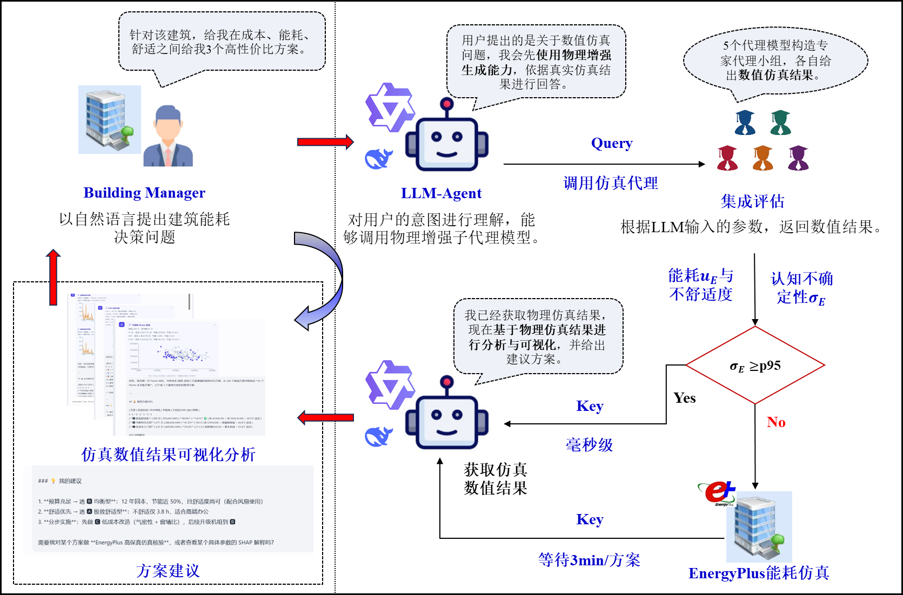

# 物理增强生成式（PAG）：大模型与算子代理协同的建筑能耗仿真智能体框架

[English](README.md) | [中文文档](README_CN.md)

> 用自然语言提问，智能体调用**物理代理模型**做定量分析，并用**不确定性门控**决定何时信任代理、何时回退**真实 EnergyPlus 仿真**——知之为知之，不知则仿真。

一个物理仿真增强的 LLM 智能体，把只有专家才能驾驭的高保真建筑仿真，变成人人可对话的决策服务。



---

## 核心理念：RAG → PAG + 不确定性门控

- **PAG（Physics-Augmented Generation，物理增强生成）**：把大模型的"增强源"从"检索一段文本/一张表"升级为"调用物理引擎"——数据驱动代理 + 高保真仿真器，把数值推理从 LLM 手里接管过来，抑制数值幻觉。
- **不确定性门控**：代理是 HC-DeepONet 5 成员深度集成，输出能耗预测均值 **μ_E** 与集成分歧 **σ_E**。
  - σ_E 低（训练分布内）→ 直接采用代理结果，毫秒级；
  - σ_E 高（外推 / 极端工况，如异常气候、超范围围护参数）→ 回退**参数化 EnergyPlus 仿真**复核，数十秒级、权威。
- 分工：**LLM** 负责听懂人话、规划、解释、权衡；**物理代理 / 仿真**负责算得准。

---

## 页面与功能

- **智能体问答**（核心页）：自然语言对话，流式逐字回答；工具调用结果在对话内联渲染——门控徽章（🟢 信任代理 / 🔴 建议回退）、来源徽章（⚙ EnergyPlus 高保真）、以及逐日曲线 / Pareto 散点 / 柱状 / SHAP 等图表；回退仿真时显示实时进度。
- **设计 / 改造期**：固定南京气候，调建筑参数 → 全年冷热输入曲线、年等效不舒适、成本-稳健冷热输入-不舒适三目标 Pareto 前沿。
- **运维期**：固定建筑，调空调设定点 → 全年冷热输入曲线、夏季升温 1°C 节能量。
- **极端 / 异常年 (OOD)**：以正常气候日均为基准，选择异常年 EPW 情景（`anom_warm` / `anom_balanced` / `anom_cold`），估计日峰值与增幅。
- **特征归因**：SHAP 特征重要性与影响方向。
- **原理**：方法与口径说明。
- **训练工作台**：多轮方案对话（文本 + 建筑图片）→ 生成数据集 → 训练新的代理模型，并支持模型库管理（`GET /api/models`、`POST /api/models/select`）。
- **报告生成**：一键生成能耗与舒适性分析 PDF 报告（`POST /api/reports/energy-comfort`）。

---

## 工具层（Function Calling）

智能体可调用的 7 个工具（惰性复用后端既有推理函数，见 `backend/agent/tools.py`）：

| 工具 | 作用 | 场景 |
| --- | --- | --- |
| `predict_energy` | 单方案年能耗 μ_E + σ_E + **门控判定** | 通用 |
| `optimize_pareto` | 成本-能耗-舒适三目标 Pareto 寻优 | 设计/改造 |
| `operation_savings` | 设定点节能、夏季升温 1°C 节能量 | 运维 |
| `estimate_extreme` | 异常年 (OOD) 能耗峰值与增幅 | 极端气候 |
| `explain_features` | SHAP 驱动因素归因 | 解释 |
| `run_energyplus_simulation` | 真实 EnergyPlus 高保真仿真（约 70–80 秒，异步+进度） | 门控回退 / 权威核验 |
| `list_available_models` | 列出模型库中的建筑代理模型 | 模型选择 |

---

## 架构

```
前端 React + Vite  ──POST /api/agent/chat (SSE 流式)──►  FastAPI 后端 (:8010)
  · 智能体问答页 + 展示页 + 训练工作台                    · agent/orchestrator   Function Calling 循环（DeepSeek）
  · 工具卡片 / 门控徽章 / 内联图表 / Markdown 渲染           · agent/tools          7 个工具 schema + dispatch
                                                          · agent/gating         σ_E 门控（p95 阈值）
                                                          · agent/eplus_fallback 真实 EnergyPlus（异步+进度心跳）
                                                          · report_routes         PDF 报告生成
                                                          · training_routes       训练工作台 + 模型库
                          路径共享 ▼
                core/models（HC-DeepONet 集成）、core/weather —— 运行根目录见 backend/paths.py
```

- **Provider 抽象**：默认 DeepSeek（`deepseek-chat`，OpenAI 兼容），可一键切阿里百炼(DashScope) / OpenAI / 其它兼容端点，调用方无需改动（见 `backend/agent/config.py`）。
- **流式事件**：`delta`（文本增量）/ `tool_call` / `tool_result` / `progress` / `done` / `error`。
- 后端 CORS 已放开任意本地端口，前端端口可任意。

---

## 问答基准（`qa_benchmark/`）

一个可复现的建筑能耗问答基准，量化物理增强对数值幻觉的抑制效果。

- **题集**：45 道自然语言题（`questions/questions_v1.yaml`）——分布内 20 / 边缘 15 / OOD 10，四种题型（点预测 / 方案比较 / 节能量 / 情景估计）；题面刻意隐藏分档，防止模型靠措辞猜"该不该拒答"。
- **真值**：全部来自真实 EnergyPlus 仿真（留出集样本、设计 OOD 点、异常年 EPW），绝不用代理输出当真值。
- **对比框架**：**LLM-only** vs **LLM+RAG** vs **PAG**（代理 + 不确定性门控 + EnergyPlus 回退）；各 3 次重复（共 405 次问答，`temperature=0`）。
- **头条结果（deepseek-chat，rep 1）**：可用答案率 **PAG 97.8%（44/45）**，两条基线 **0% / 0%**；PAG 数值答案中位误差分布内 **1.4%**、边缘 **2.1%**、OOD **≈0%**（EnergyPlus 回退），基线对应 ~198% / ~16.6% / ~64.9%；门控零漏报、参数解析 61/61 全对、比较题方向 10/10。延迟中位：代理路径 **5.2 s**，回退路径 **40.9 s**。
- **模型扫描**（`results/model_sweep/`）：同一套三框架在 Gemini 3.5 Flash / GPT-5.5 / Qwen3.7-Plus 上的对照，含原始 JSONL、判分 CSV 与图表（判定堆叠图、误差条带图、按框架×模型的雨云图 / 箱线图）。
- **可复现**：`questions/make_questions.py` 固定随机种子；全部运行与判分脚本在 `runners/`（`run_llm_only.py`、`run_llm_rag.py`、`run_pag.py`、`run_model_matrix.py`、`score.py`、`score_model_sweep.py` 等）。

---

## 目录结构

```
EnergyPlus-Agent/
├─ backend/
│  ├─ app.py                 # FastAPI 主应用（展示端点）+ 三个 router（agent/report/training）
│  ├─ report_routes.py       # /api/reports/* —— PDF 报告生成
│  ├─ training_routes.py     # 训练工作台 + 模型库（/api/models）
│  ├─ requirements.txt
│  ├─ .env                   # 大模型密钥（gitignore，不入库）
│  └─ agent/
│     ├─ config.py           # Provider 抽象 + 零依赖 .env 加载
│     ├─ llm.py              # OpenAI 兼容客户端封装
│     ├─ routes.py           # /api/agent/chat (SSE) + /api/agent/health
│     ├─ orchestrator.py     # 流式 Function Calling 循环 + 系统提示
│     ├─ tools.py            # 7 个工具
│     ├─ gating.py           # σ_E 不确定性门控
│     └─ eplus_fallback.py   # 真实 EnergyPlus 回退（异步+进度）
├─ frontend/
│  └─ src/
│     ├─ App.jsx             # 首页 + 路由（智能体问答、展示页、训练工作台）
│     ├─ AgentPage.jsx       # 对话页（流式 / 工具卡片 / Markdown）
│     ├─ ChatCharts.jsx      # 对话内联图表（Recharts）
│     ├─ TrainingPage.jsx    # 训练工作台
│     ├─ agent.css / styles.css / training.css
│     └─ api/client.js       # SSE 解析
├─ core/                     # 仿真/训练核心模块（几何、IDF 模板、采样、HC-DeepONet 训练）；
│                            #   Release 资产解压于此：models/、weather/、datasets/weather_ood/
├─ qa_benchmark/             # 问答基准：题集、runners、结果（见上）
├─ scripts/
│  └─ start.ps1              # 一键启动（后端 :8010 + 前端 :5173）
├─ Frame.png                 # 英文框架图
└─ Frame_zh.png               # 中文框架图
```

---

## 预训练模型与气象文件

运行所需资产发布在 [Release v1.0.0](https://github.com/Zhangchaokai1/EnergyPlus-Agent/releases/tag/v1.0.0)，两个压缩包都解压到 `core/`：

| 资产 | 内容 |
| --- | --- |
| `energyplus-agent-models-v1.0.0.zip`（约 8.7 MB） | 训练好的 5 成员 HC-DeepONet 集成（权重、scaler）、σ_E 门控阈值、运行时 SHAP 表 |
| `energyplus-agent-weather-v1.0.0.zip`（约 1.1 MB） | 南京 TMYx 基准 EPW + 异常年 EPW（`anom_warm` / `anom_cold` / `anom_balanced`） |

```bash
cd EnergyPlus-Agent/core
curl -LO https://github.com/Zhangchaokai1/EnergyPlus-Agent/releases/download/v1.0.0/energyplus-agent-models-v1.0.0.zip
curl -LO https://github.com/Zhangchaokai1/EnergyPlus-Agent/releases/download/v1.0.0/energyplus-agent-weather-v1.0.0.zip
unzip energyplus-agent-models-v1.0.0.zip && unzip -o energyplus-agent-weather-v1.0.0.zip
sha256sum -c SHA256SUMS
```

训练/仿真数据集体积较大，不随仓库发布；基准逐日气候特征在启动时由 EPW 直接计算。训练新模型与 EnergyPlus 回退仿真需本机安装 EnergyPlus。

## 环境配置

**1) 后端密钥** —— `backend/.env`（已在 `.gitignore` 中，不入库）：

```dotenv
LLM_PROVIDER=deepseek
DEEPSEEK_API_KEY=sk-你的密钥
```

切换到阿里百炼(DashScope)：`LLM_PROVIDER=dashscope` + `DASHSCOPE_API_KEY=...`；切 OpenAI：`LLM_PROVIDER=openai` + `OPENAI_API_KEY=...`。也可用 `LLM_BASE_URL` / `LLM_MODEL` / `LLM_API_KEY` 显式覆盖。

**2) 前端请求地址** —— `frontend/.env.local`：

```dotenv
VITE_API_BASE=http://127.0.0.1:8010
```

后端端口若改动，这里要同步改并重启 `npm run dev`。

---

## 运行

推荐直接使用启动脚本（智能体后端 **8010**，前端 **5173**，缺失依赖时自动 `npm install`）：

```powershell
cd EnergyPlus-Agent
.\scripts\start.ps1
```

也可以分两个终端手动启动：

```powershell
# 终端一：后端（建议不加 --reload，Windows 下 --reload 退出易残留占端口）
cd EnergyPlus-Agent
python -m uvicorn backend.app:app --host 127.0.0.1 --port 8010

# 终端二：前端
cd EnergyPlus-Agent\frontend
npm install
npm run dev        # http://127.0.0.1:5173
```

- 健康检查：`GET http://127.0.0.1:8010/api/agent/health` → `{provider, model, configured}`。
- 模型库检查：`GET http://127.0.0.1:8010/api/models` → `{selected, models}`。
- 端口被僵尸进程占用时（Windows）：`taskkill /F /IM python.exe` 清理后重启。

## 打包前端

```powershell
cd EnergyPlus-Agent\frontend
npm run build      # 产物在 frontend/dist
```

---

## 前置依赖与说明

- **运行根目录**：由 `backend/paths.py` 决定模型、气象文件与核心模块的位置——优先环境变量 `PAG_RUNTIME_ROOT`；否则若上一级目录已包含核心模块（研究工作区布局）则用上一级；否则使用仓库自带的 `core/`（新 clone 的默认情况）。
- **回退仿真需要 EnergyPlus**：`run_energyplus_simulation` 会调用真实 EnergyPlus（默认二进制 `D:\Program Files\EnergyPlusV25-2-0`，南京 EPW，75 区办公楼全年模拟，约 70–80 s）。未安装 EnergyPlus 时其余代理功能仍可用，仅高保真回退不可用。
- **模型口径**：输入 10 维静态建筑/系统变量 + 20 维逐日气候特征；输出日冷负荷 / 日热负荷 / 日人员加权等效不舒适小时（`|PMV|>1.5`）。供冷设定点 `[24,28] °C`，供暖设定点 `[16,20] °C`。对象为南京一栋约 19440 m² 的高层办公原型。
- **Python 依赖**：见 `backend/requirements.txt`（fastapi / uvicorn / torch / numpy / pandas / scipy / scikit-learn / joblib / openai / python-multipart / matplotlib / reportlab）。
- **门控阈值**：取自验证集 σ_E 分布 p95（`core/models/office_hc_deeponet_ensemble/evaluation/ood_gate_recall.csv`）；该阈值下 OOD 召回 100%、分布内误报约 5.2%。

## 许可证

本项目基于 [MIT License](LICENSE) 开源。
